# ha-family-panel

[](https://www.home-assistant.io/integrations/marketplace/)
[](https://github.com/juju35/ha-family-panel/actions/workflows/hacs.yml)
[](https://github.com/juju35/ha-family-panel/actions/workflows/validate.yml)
[](https://github.com/juju35/ha-family-panel/actions/workflows/lint.yml)
[](https://github.com/juju35/ha-family-panel/releases/latest)
[](https://github.com/juju35/ha-family-panel/blob/main/LICENSE)
[](https://buymeacoffee.com/julienstep9)

<p align="center"></p>

<p align="center"><a href="https://www.index-education.com/fr/logiciel-gestion-vie-scolaire.php"></a> <a href="https://github.com/juju35/ha-ent-one"></a> <a href="https://github.com/juju35/ha-ent-educartable"></a> <a href="https://github.com/juju35/ha-ent-skolengo"></a> <a href="https://families.google/familylink/"></a> <a href="https://mealie.io/"></a> <a href="https://www.getbring.com/"></a> <a href="https://donetick.com/"></a> <a href="https://github.com/mampfes/hacs_waste_collection_schedule">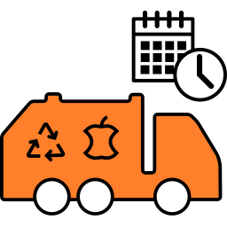</a> <a href="https://github.com/juju35/ha-saint-of-the-day"></a></p>

Home Assistant integration that adds a **Family** panel to the sidebar: the children's school day, the family calendars, the week's meals and shopping list, the chores and the screen time, on one page — read from the integrations you already have (Pronote, ENT ONE, Educartable, Skolengo, Family Link, Mealie, Bring!, Donetick, Waste Collection Schedule…).

<p align="center">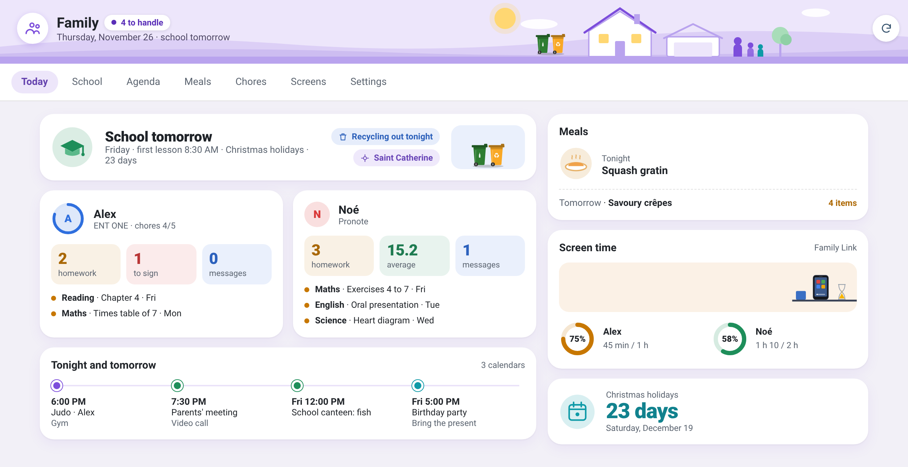</p>

[](https://my.home-assistant.io/redirect/marketplace_repository/?owner=juju35&repository=ha-family-panel&category=integration)

## Features

- **Illustrated top bar**: a house with its garden and bins, day picture with a light theme and night with a dark one, a status pill (what needs handling, or all good), the date and whether there is school tomorrow, and a round **Refresh** button; pill-shaped tabs under it
- **Today**: one card per child — homework, things to sign, unread messages, average and chores done — then tomorrow (school day or not, first lesson), tonight's bin and the name day, tonight's and tomorrow's meals, the day's events, screen time and countdowns
- **School**: each child's lessons of tomorrow (cancelled ones flagged), homework to do, averages and school life (absences, delays, unread messages)
- **Agenda**: the family calendars over a week, one colour per calendar, with previous / today / next
- **Meals**: the week's lunches and dinners from the meal plan, and the shopping list — tick items off or add one
- **Chores**: the week's chores, done, due or overdue, ticked off from the panel
- **Screens**: each child's Family Link screen time against the daily limit, the time left, bedtime and blocked apps, with **+15 min**, **Lock / Unlock** and **Ring** buttons
- **Settings**: the sources the panel found, the header picture (follows the theme, always day, always night) and **Administrators only**
- Children are merged by first name across the school integrations and Family Link: one card per child
- Clean empty states when a source is missing, light and dark themes, phones and desktops, 22 languages
- No account of its own: the panel reads the entities of the other integrations and calls their services, with the permissions they have

## Supported integrations

| | Integration | What it is used for |
|---|---|---|
|  | [Pronote](https://github.com/delphiki/hass-pronote) | School: timetable, homework, averages, school life, messages and things to sign |
|  | [ENT ONE](https://github.com/juju35/ha-ent-one) | School: homework and messages of the ONE school workspace |
|  | [Educartable](https://github.com/juju35/ha-ent-educartable) | School: homework, liaison book and surveys |
|  | [Skolengo](https://github.com/juju35/ha-ent-skolengo) | School: timetable, homework and grades of the Skolengo ENT |
|  | [Family Link](https://github.com/juju35/ha-family-link) | Screens: screen time, daily limit, bedtime, blocked apps, lock, bonus and ring |
|  | [Mealie](https://www.home-assistant.io/integrations/mealie/) (built in) | Meals: its meal plan calendars and its shopping lists |
|  | [Bring!](https://www.home-assistant.io/integrations/bring/) (built in) | Meals: the shopping list |
|  | [Donetick](https://github.com/donetick/donetick-hass-integration) | Chores: the chore lists, done, due or overdue |
|  | [Waste Collection Schedule](https://github.com/mampfes/hacs_waste_collection_schedule) | Today: the bin to put out tonight |
|  | [Saint of the day](https://github.com/juju35/ha-saint-of-the-day) | Today: the name day |
| | [Calendar](https://www.home-assistant.io/integrations/calendar/) (built in) | Agenda: any calendar — local, Google, CalDAV… |
| | [To-do list](https://www.home-assistant.io/integrations/todo/) (built in) | Meals and Chores: any to-do list, including the built-in [Shopping list](https://www.home-assistant.io/integrations/shopping_list/) |
| | [Workday](https://www.home-assistant.io/integrations/workday/) (built in) | Today: whether tomorrow is a school day |
| | [Person](https://www.home-assistant.io/integrations/person/) (built in) | Settings: the family members |

## Prerequisites

Home Assistant 2026.11 or later, and at least one of the integrations above: the panel shows what it finds and leaves the rest out.

## Installation

### Via the Marketplace (recommended)

Click the button below to add the repository directly:

[](https://my.home-assistant.io/redirect/marketplace_repository/?owner=juju35&repository=ha-family-panel&category=integration)

Then click **Install** and restart Home Assistant.

Or manually:

1. Open **Settings → Marketplace → Add from link** (top right; this needs a GitHub account connected)
2. Add `https://github.com/juju35/ha-family-panel` — Type: **Integration**
3. Open **Family Panel** and click **Install**, then restart Home Assistant

Then **Settings → Devices & services → Add integration → Family Panel**: the **Family** entry appears in the sidebar. The integration serves the panel itself; nothing to add under `/local/community/` or in the dashboard resources.

### Manual

1. Download `family_panel.zip` from the [latest release](https://github.com/juju35/ha-family-panel/releases/latest)
2. Extract it to `/config/custom_components/family_panel/`
3. Restart Home Assistant and add the **Family Panel** integration

## Configuration

The sources are found by integration: the children from the school integrations and Family Link, the calendars (up to six, school, meal and waste calendars left out), the meal plans, the shopping and chore lists, the waste collections, the name day and the workday sensor. To choose them yourself, open **Settings → Devices & services → Family Panel → Configure**:

| Option | Entities | Left empty |
|---|---|---|
| Family members | `person` | Every person |
| Calendars | `calendar` | The calendars found |
| Meal plans | `calendar`, `todo`, `sensor` | Mealie and Cookidoo |
| Shopping lists | `todo` | Shopping list, Bring!, Mealie, OurGroceries, AnyList |
| Chores | `todo`, `sensor` | Donetick, Grocy, or to-do lists named after chores |
| Waste collections | `sensor`, `calendar` | Waste Collection Schedule |
| Countdowns | `sensor`, `calendar`, `input_datetime` | None |

The panel's own settings (header picture, administrators only) are in its **Settings** tab, for administrators.

## Panel

The **Family** entry of the sidebar, at `/family`. Every user sees it, unless **Administrators only** is on.

| Light | Dark |
|---|---|
|  | 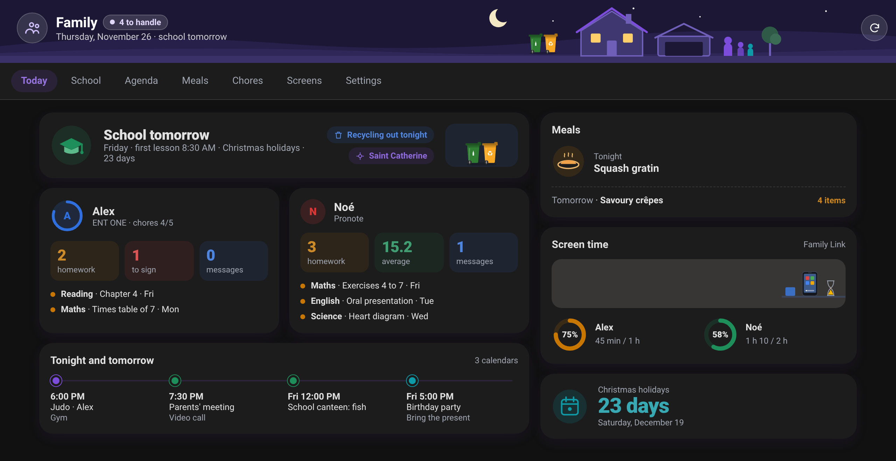 |
| 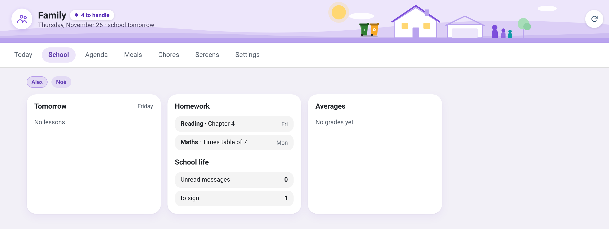 | 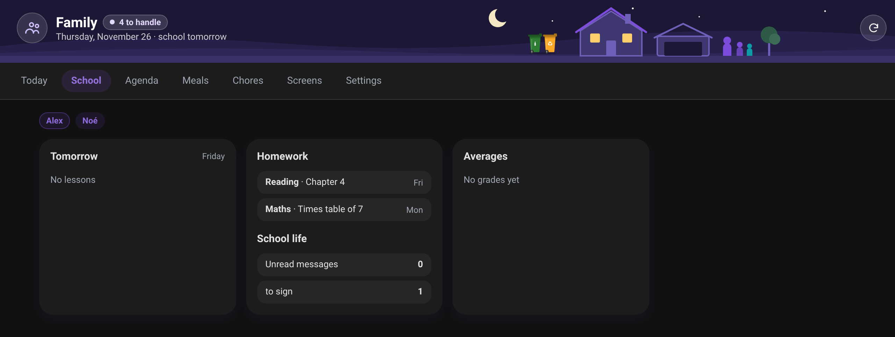 |
| 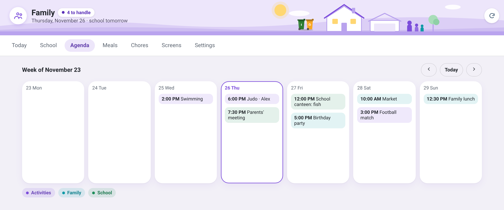 | 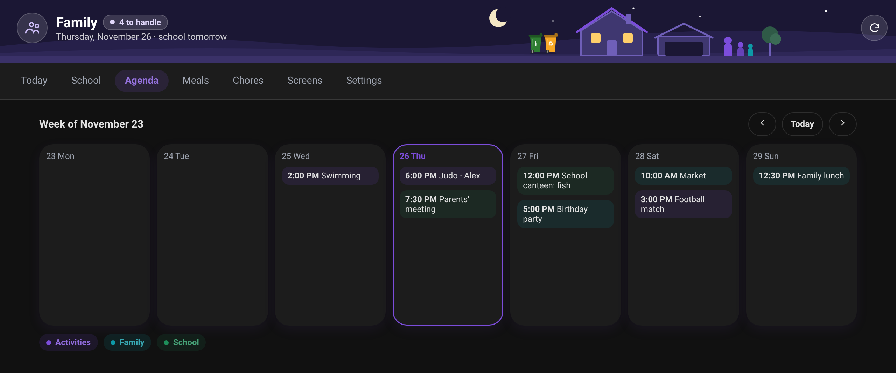 |
| 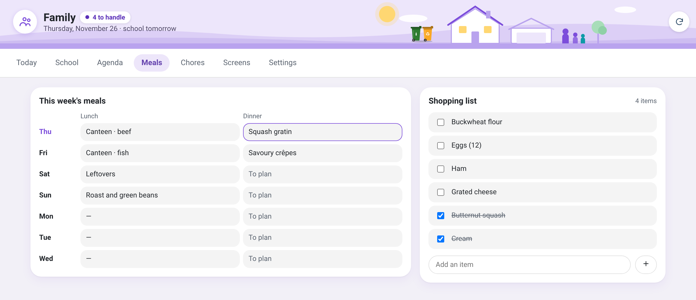 | 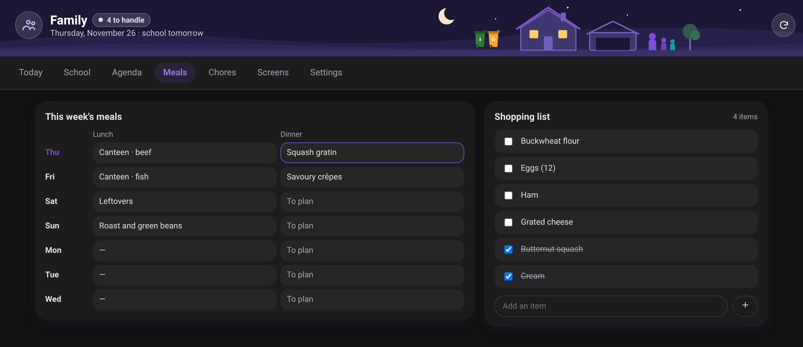 |
| 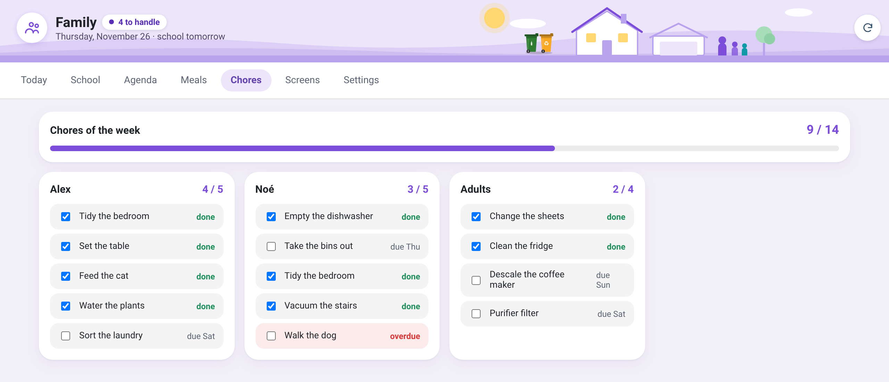 | 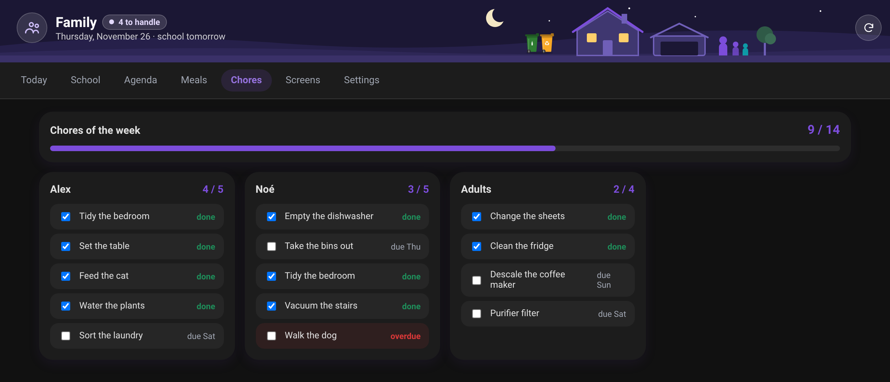 |
| 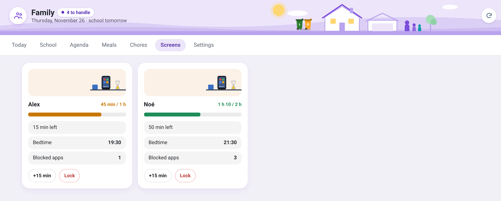 | 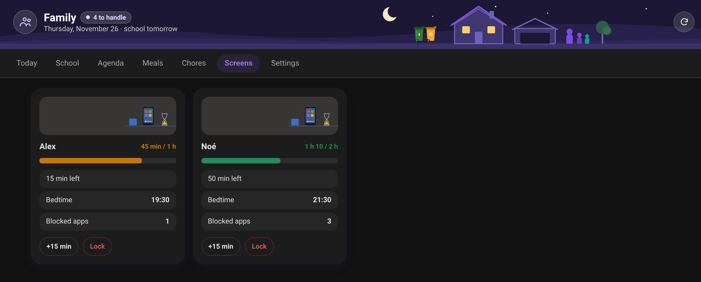 |

## How it works

The integration reads the device and entity registries, groups each school or Family Link device under its child (by first name), recognises each entity's role from its translation key (or its entity ID for older integrations) and hands the panel this inventory over a WebSocket command; the inventory is rebuilt when a device or an entity changes. The panel then reads the states it needs, fetches calendar events and to-do items through Home Assistant's own APIs, and calls the integrations' services (`todo.update_item`, `todo.add_item`, `button.press`, `switch.toggle`) for its buttons.

## Development

```sh
npm ci
npm run build          # assembles src/family-panel/ into custom_components/family_panel/frontend/family-panel.js
npm test               # node --test test/*.test.mjs
npm run screenshots    # renders screenshots/ with the mock data of scripts/mock-states.mjs
pip install -r requirements_test.txt && pytest
```

### Releasing

A release follows every `feat` or `fix` merge on `main` whose version has no tag yet; the workflow builds `family_panel.zip` with the assembled panel.

## Translations

| English | `en` |
| Français | `fr` |
| Deutsch | `de` |
| Español | `es` |
| Српски | `sr` |
| Srpski (latinica) | `sr-Latn` |
| Italiano | `it` |
| Nederlands | `nl` |
| Português (Portugal) | `pt` |
| Polski | `pl` |
| Română | `ro` |
| Dansk | `da` |
| Svenska | `sv` |
| Български | `bg` |
| Русский | `ru` |
| Українська | `uk` |
| Magyar | `hu` |
| Slovenčina | `sk` |
| Čeština | `cs` |
| Slovenščina | `sl` |
| Latviešu | `lv` |
| Ελληνικά | `el` |

Regional variants fall back to the base language (`it-IT` → `it`, `nl-BE` → `nl`); Brazilian Portuguese (`pt-BR`) uses the European Portuguese translation.

Contributions for additional languages are welcome!

## Trademark

Pronote, Family Link, Mealie, Bring!, Donetick and the other names and logos above belong to their owners. This project is not affiliated with or endorsed by them; the logos are used only to identify the integrations it works with.

## License

[MIT](https://github.com/juju35/ha-family-panel/blob/main/LICENSE)

## Support

If you find this project useful, you can support its development:

<a href="https://buymeacoffee.com/julienstep9"></a>
